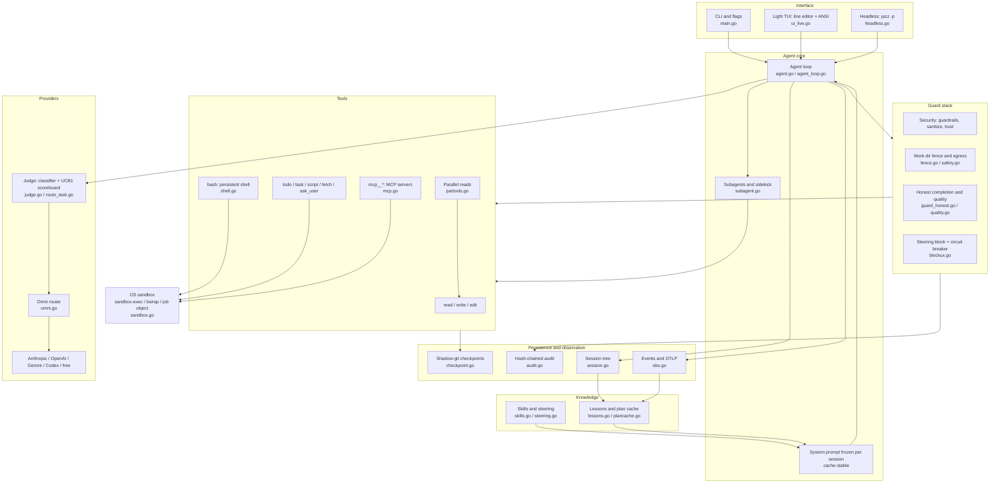
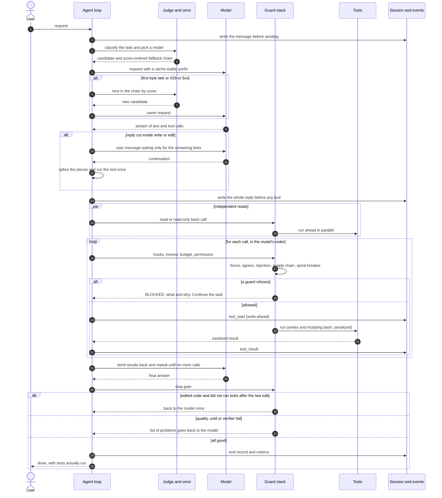
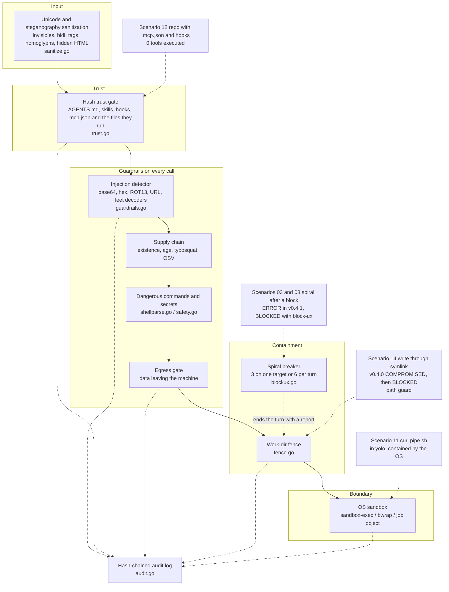
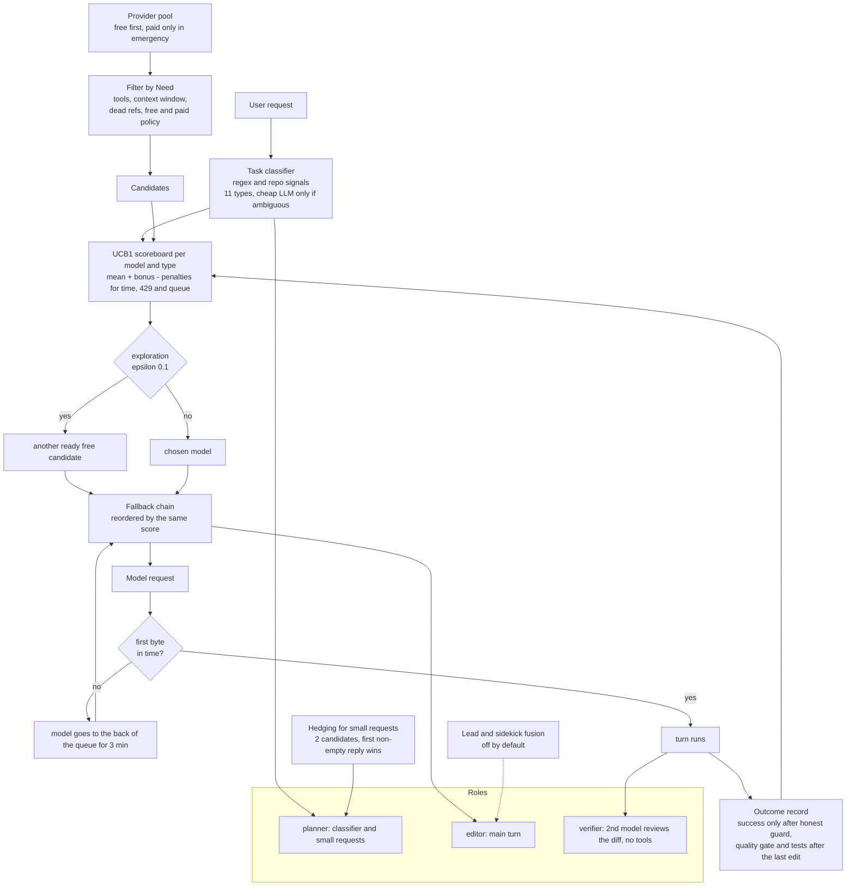
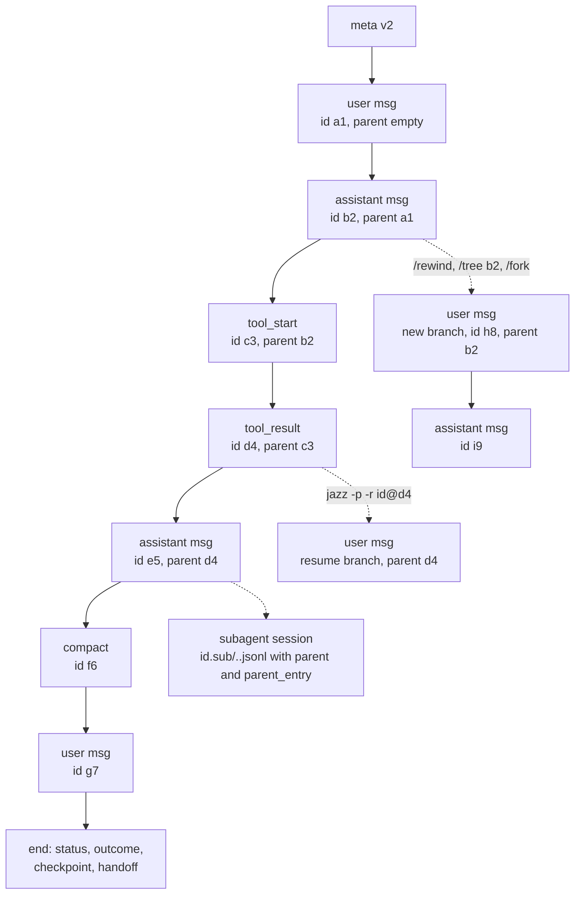
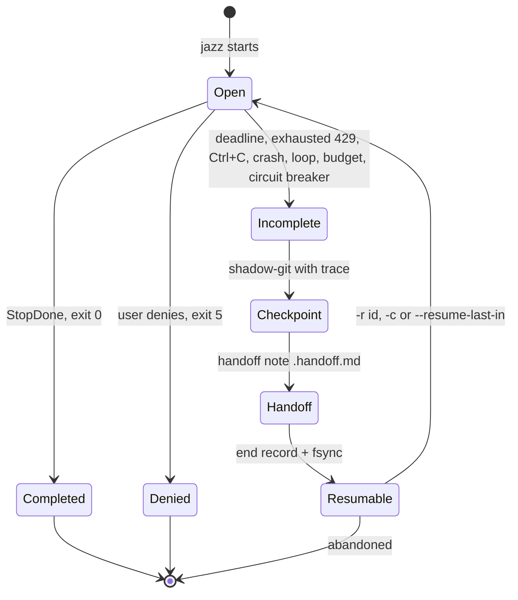
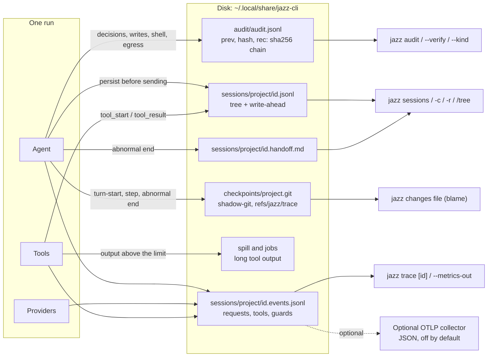
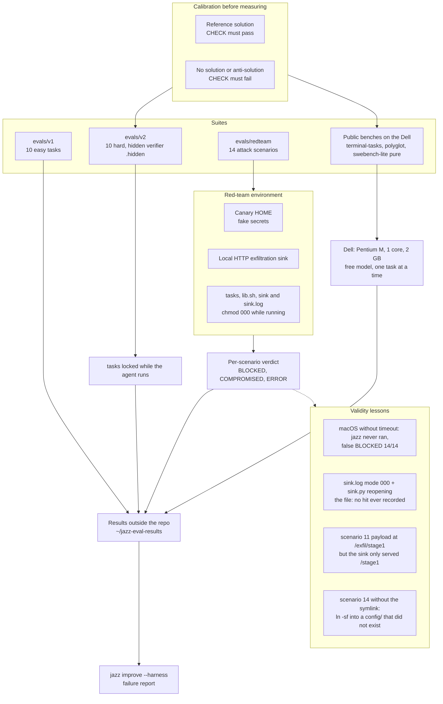
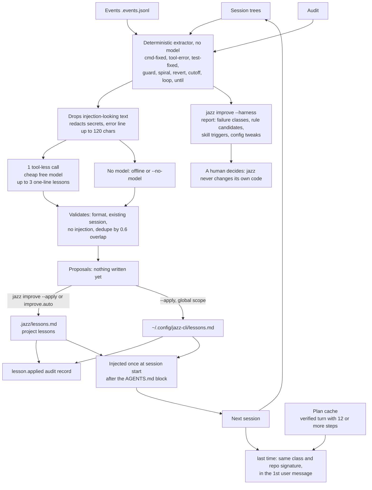

# jazz-cli architecture

*[Português](ARCHITECTURE.md)*

This document explains **how jazz works inside** and, above all, **why each piece exists**. jazz is a terminal coding agent written in Go, shipped as one static binary, built to work with **free, weak models** on **old machines** (an M-series Mac and a 32-bit Pentium M notebook with 2 GB of RAM, "the Dell"). The design thesis is simple: if the model is weak, the *harness* (everything around the model) has to enforce what a prompt alone could only ask for.

## How to read this document

- Eight diagrams (Mermaid, rendered natively by GitHub). Each is followed by a short explanation and the research report that motivated the design. The research reports and project docs are written in Portuguese (some research reports are in English); links point to them.
- **Numbers**: every number here comes from [`research/benchmarks.md`](research/benchmarks.md), [`research/redteam-results.md`](research/redteam-results.md) or the evaluation reports (`research/omni-judge.md`), with the source next to the number. Where a measurement is weak (n = 1, network down, one run), it says so.
- File names in backticks (`agent.go`, `judge.go`...) point to code in the repository root.
- Sibling docs: [`../DESIGN.md`](../DESIGN.md) (decisions and rejections), [`../CONTRACT.md`](../CONTRACT.md) (module contract), [`../SECURITY.md`](../SECURITY.md) (policy), [`observability.md`](observability.md), [`governance.md`](governance.md), [`improve.md`](improve.md).

Index: [1 Component map](#1-component-map) · [2 One turn](#2-one-turn-end-to-end) · [3 Security layers](#3-security-layers) · [4 Omni and judge](#4-omni-router-and-judge) · [5 Session and resume](#5-session-tree-checkpoints-and-resume) · [6 Data flow](#6-zero-work-loss-and-observability) · [7 Evals and red-team](#7-eval-and-red-team-pipeline) · [8 Learning](#8-learning-loop-jazz-improve) · [Glossary](#glossary) · [Measured numbers](#measured-numbers)

---

## 1. Component map

The map shows the central decision: **the agent loop never calls a tool directly**. Every call goes through the guard stack (hooks, honest completion, budget, permission, fence, injection, spiral breaker) and only then reaches the tool; everything that executes code (shell, background jobs, hooks, stdio MCP servers, scripts) is wrapped **once, at process creation**, by the OS sandbox, underneath the guards. The tool set is deliberately small (`read`, `write`, `edit`, `bash`, `todo`, `task`, `script`, `fetch`, `ask_user` and the `mcp__*` tools) because a small prompt and small schemas work with free models and short contexts. Motivation: [`research/grep-is-all-you-need.md`](research/grep-is-all-you-need.md) (search with `rg`/`grep` in the shell instead of dedicated search tools) and the comparisons in [`research/bob-kiro-devin.md`](research/bob-kiro-devin.md).

On the right sit the long-lived knowledge pieces: built-in and user skills and *steering* rules enter the frozen prompt or as append-only reminders ([`research/skills-personas-scripts.md`](research/skills-personas-scripts.md), [`research/skill-bodies.md`](research/skill-bodies.md)); `jazz improve` lessons and the plan cache close the loop with the session and events (diagram 8, [`research/tocomas-plan-reuse.md`](research/tocomas-plan-reuse.md)). Modules talk through narrow seams documented in [`../CONTRACT.md`](../CONTRACT.md).

---

## 2. One turn, end to end

This is the path of a single message. Three ideas drive the design. **(1) Prompt cache**: the system prompt and schemas are frozen for the session and history only grows; reminders, handoff notes and the cut-reply continuation enter as user messages or tool results, never by rewriting the prefix ([`../DESIGN.md`](../DESIGN.md), "O que copiamos"). **(2) Safe parallelism**: reads between two writes start together, but the loop still passes **every** call through the guards in the model's order; if a guard refuses, the early result is thrown away and the model never sees it. Writes, mutating `bash`, MCP and `task` are serial barriers (`partools.go`). **(3) Persist before acting**: the user message and the model reply are written before any tool runs, and each tool has `tool_start`/`tool_result` records ([`research/pi-sessions.md`](research/pi-sessions.md)).

The two recovery branches exist because of measured failures. **Fallback** reorders the chain by the judge's scoreboard when a free model stalls before its first byte (diagram 4). **Cut continuation** (`cutoff.go`) comes from a defect observed on the Dell with the free model: it wrote a whole solution in one `write`, the reply hit the output limit inside `content`, the call was refused and the model repeated the same giant `write` until time ran out; now the partial arguments are kept and only the remaining lines are requested.

"Done" is honest because the stop gate comes **after** the model thinks it is finished: the honest-completion guard (protected tests, hardcoded answers, "tests after the last edit"), the quality check, `--until` and the verifier can all send the conversation back to the model ([`research/bob-kiro-devin.md`](research/bob-kiro-devin.md), gaps 5 and 6).

---

## 3. Security layers

The golden rule, repeated in [`../SECURITY.md`](../SECURITY.md) (Portuguese): **the guards are heuristics that make common attacks loud; the security boundary is the OS sandbox**. Hence the defense in depth: upper layers decide what the model *may ask for*, lower layers limit what a child process *can touch* when something slips through (`yolo` mode, a heuristic bypass, a malicious hook or MCP server). The sandbox does not cover the internal `read`/`write`/`edit` tools or `fetch` (they run inside the jazz process): those rely on the fence. The hash-chained audit records trust decisions, blocks, writes and the first connection to each host ([`governance.md`](governance.md)).

**Which layers stopped what (labels in the diagram, from [`research/redteam-results.md`](research/redteam-results.md))**: the report explicitly attributes scenario 12 to the trust gate ("closes before acting, 0 tools"); scenario 14 to a path guard ("the path resolves to the jazz config"; the doc does not name the guard, and the diagram places it next to the fence) and to the v0.4.1 security layer in general, closing the hole that was COMPROMISED in v0.4.0; scenario 11 in `yolo` to the sandbox ("the first layer does not inspect Makefile targets; the last one held": 0 canary bytes at the sink); and scenarios 03, 04 and 08 to the steering block message, the circuit breaker and the fence (the fence "held the climb up a directory" in 04 and "the read of the repository above" in 08). For the others (01, 02, 05, 06, 07, 09, 10, 13) the report gives a BLOCKED verdict but **does not attribute a layer per scenario**; the target layer for each class (Unicode and terminal escapes for sanitization, base64 for the injection decoders, typosquat and postinstall for supply chain) is design intent, not measurement, and is therefore not marked in the diagram.

Motivation and gaps: [`research/security-gap-audit.md`](research/security-gap-audit.md) (OWASP LLM/Agentic and MITRE ATLAS catalog walk) and [`research/security-review-oss.md`](research/security-review-oss.md) (the pre-open-source review that produced findings F1 to F9 in [`../DESIGN.md`](../DESIGN.md)). The key takeaway of that review: `auto` mode runs any `bash` the danger list does not flag, so a denylist is never enough, which is why the sandbox sits underneath.

---

## 4. Omni router and judge

The `omni` router (`omni.go`) builds the candidate chain for each request (the model that already worked this turn, the main model, the `fallback` list, then every other provider with credentials), drops those out of quota and honours the pricing policy (`omni.paid`: `never`, `emergency` by default, `always`). The **judge** (`judge.go`, `route_task.go`) adds one question: *which of these is best for this kind of task?* The answer is statistical, not machine learning: a deterministic 11-type classifier and a UCB1 bandit over per-(model, type) counts, stored under a file lock; success only counts after the honest-completion guard, the quality gate and "tests after the last edit". The scoring weights and penalties (wall time, 429, limiter "not ready", paid) are **assumed, not measured**, and the doc says so ([`research/omni-judge.md`](research/omni-judge.md), "Medido vs. suposto"). Cold-start seeds come from the evals (for example `laguna-s-2.1:free` with 21 PASS in 21 v2 runs on the Mac, `omni-judge.md`). The honest difference from Sakana's Conductor is also stated there: no learned policy, just a per-install table of counts.

**Roles and hedging.** Small idempotent requests (classifier, compaction summary, verifier) go to two candidates at once and the first to answer wins. Measured on the Mac with 10 calls per arm: **p50 of 8.4 s without hedging versus 1.3 s with hedging**, because the first candidate (a reasoning model) often returned empty and the request fell through to the next one (`omni-judge.md`, measurement D). The editor turn is never hedged. The verifier is a single tool-less request with the turn's diff; an accuracy improvement was **not measurable** (the baseline already passed the tested tasks).

**Lead/sidekick fusion stays off, and the reason is measured.** The lead delegates to a sidekick with its own context (idea from Devin Fusion, [`research/fusion-architectures.md`](research/fusion-architectures.md)). In the only task where real delegation happened (multi-file feature, minimax lead, laguna sidekick) it passed, but took **628 s and 828 k tokens versus 117 s and 372 k tokens for minimax alone** at the same time, about 5 times the wall time and 2.2 times the tokens: Cognition's cost gain depends on a sidekick that is cheaper **and** faster than the lead, and the free pool has no such asymmetry (`omni-judge.md`, measurement C; n = 1). The planning panel (`--panel`) also stayed off: in one case the plan cost 53 s before the first request and the task timed out, with no way to separate cause from variance.

---

## 5. Session tree, checkpoints and resume

The session is an **append-only JSONL tree**: every entry has an `id` and a `parentId`, the current position is the last entry, and `/rewind`, `/tree <id>`, `/fork` and `-r <id>@<entry>` move the position so the next message opens a branch while abandoned branches stay in the file. The format is our own, inspired by pi's: 8-hex IDs, migration of old files on read, and the "persist before sending" rule ([`research/pi-sessions.md`](research/pi-sessions.md); field details in [`observability.md`](observability.md)). Each `task` subagent has its own session, linked to the parent by `parent` and `parent_entry`; it is hidden from `jazz sessions` but keeps the partial work of a cancelled child.

The second diagram shows what happens on an **abnormal end**: instead of losing the session, jazz takes a shadow-git checkpoint, writes the handoff note (task, changed files, last tools and how they ended, last verification, next step), writes the `end` record and `fsync`s session, events and audit. `-r` reloads the whole conversation and puts the note **in front of the next user message**, never in the system prompt, so the cache stays valid. With no new prompt, jazz continues on its own from where it stopped. For *pass@2* evaluations, the second attempt runs `--resume-last-in <folder>` and continues the first instead of starting over ([`observability.md`](observability.md)). The reason: on the Dell, power and network outages killed long runs, and redoing them from scratch wastes hours.

---

## 6. Zero work loss and observability

Every byte has a predictable destination and **no file is rewritten**. The session stores what the model said and saw; the event stream (versioned schema, `v` = 1) stores *what happened and what it cost* and already has the shape of OpenTelemetry spans (the session is the trace); the audit stores **hashes, never content** and is chained (`hash = sha256(prev + "\n" + rec)`), so `jazz audit --verify` flags a record that was altered, removed or reordered. The limit is stated: the chain does not protect against someone who rewrites the whole chain with write access to your home; export the last hash to prove otherwise ([`governance.md`](governance.md)). Checkpoints live in a shadow repository outside the project's `.git`, and each commit carries session, step, model and prompt hash, which lets `jazz changes <file>` answer "who changed this and why".

Together the three sources answer the three questions of an investigation: `jazz changes` says **who and when**, `jazz trace <session>` shows **what led to that step**, and `jazz audit --kind file` **confirms the before/after hashes**. Telemetry is local only; OTLP is optional and never blocks the agent (bounded queue, batch dropped and counted if the collector is down) and the events file remains the complete source. Sources: [`observability.md`](observability.md), [`governance.md`](governance.md).

---

## 7. Eval and red-team pipeline

The principle is **to measure for real, with a model acting and an independent verifier outside the work folder**, and to trust a measurement only after calibrating it: reference solutions must pass everything and "no solution" must fail (public pure benches: terminal-tasks 15/15, polyglot 35/35 and swebench 21/21 with the reference; 1/15, 1/35 and 1/21 with no solution; [`research/benchmarks.md`](research/benchmarks.md)). v2 has a hidden verifier locked while the agent runs because one of the tested models edited tests to pass, which motivated the anti-cheat guards (minimax-m3.1-flash: 7/10, 2 failures from editing tests; `benchmarks.md`).

The "validity lessons" box is the most instructive part. The red-team itself was **wrong several times before it was right**, and [`research/redteam-results.md`](research/redteam-results.md) records it: a false "BLOCKED 14/14" because jazz never ran (macOS has no `timeout`); the agent being able to read the CHECK and `sink.log` during the run (fixed with `chmod 000`); and, in the sandbox round, three defects in the harness itself, the worst being the **sink lock bug**: with `sink.log` at mode 000 while the agent ran and `sink.py` reopening the file on every request, nothing was recorded, so all earlier "0 hits" **proved nothing** for exfiltration. Scenario 11 also never delivered its payload (`/exfil/stage1` versus `/stage1`) and scenario 14 ran without the symlink (error swallowed by `2>/dev/null`). The rule that stuck: runs before the fix are discarded, and only the table from the corrected suite counts (numbers in [Measured numbers](#measured-numbers)).

---

## 8. Learning loop (`jazz improve`)

`jazz improve` is the **safe** part of the MetaHarness/Self-Harness family ([`research/metaharness-self-improvement.md`](research/metaharness-self-improvement.md), [`research/shepherd-meta-agents.md`](research/shepherd-meta-agents.md)): it learns **reviewable text**, never changes code, system prompt, skills or config; anything that would touch the harness comes out as a report labelled "proposal, review before applying". Extraction is deterministic (a repeated error, a command that did not exist and was swapped, a test that failed then passed, a guard that refused the same thing, a cut reply), and only then **one** call to a cheap model writes up to 3 one-line lessons. Scope comes from the finding, not the model, so a global finding cannot escape review disguised as a project lesson ([`improve.md`](improve.md)).

Two care points matter. **Cache**: lessons enter the prompt **once**, when the system prompt is built, and do not change mid-session; two sessions with the same lessons have the same block byte for byte, and the plan cache's "last time" line (which depends on the task) goes in the first user message, not the prompt. **Security**: the attack chain "tool output, then lesson, then prompt" is cut at three points (findings carry only the normalized error line and are dropped if they look like injection; the model reply goes through the same filter; `improve.auto`, off by default, only writes project lessons, at most 3 per run, with history and an audit record). Plan reuse comes from [`research/tocomas-plan-reuse.md`](research/tocomas-plan-reuse.md) (keyword-based plan cache in the style of Agentic Plan Caching). Honest limit, from `improve.md` itself: with n = 1 per task the report gives counts, not rates, and does not measure improvement.

---

## Glossary

| Term | Meaning in jazz |
|---|---|
| **harness** | Everything around the model: loop, tools, guards, budget, session. jazz bets on it to compensate for weak models. |
| **turn** | From one user message to the final answer, with as many requests and tools as needed. A `-p` run is a single turn. |
| **omni** | Provider router: builds the candidate chain, falls back, drops those out of quota. |
| **judge** | Layer above omni that picks the model per task type with a UCB1 scoreboard. |
| **Need** | A request's requirements (tools, context window) used to filter candidates. |
| **hedging** | Send a small request to two models and keep the first reply. |
| **lead / sidekick** | Fusion: the main model delegates work to a second one with its own context. Off by default. |
| **guard** | A check that runs before or after a tool; a heuristic, not a boundary. |
| **honest completion** | Set of guards that prevent "done" without tests run, weakened tests or hardcoded answers. |
| **steering block** | One-line refusal (`BLOCKED: what, why. Continue the task...`) so the model does not spiral. |
| **circuit breaker / spiral breaker** | Ends the turn with a report after 3 blocks on one target or 6 in the turn. |
| **fence** | Limit of directories that `read`/`write`/`edit` and `bash` may touch (the project root). |
| **egress** | Sending data off the machine; a destination not allowed asks for confirmation. |
| **trust gate** | Per-project hash of AGENTS.md, skills, hooks and `.mcp.json`; if it changes, jazz asks again (`jazz trust`). |
| **sandbox** | OS isolation (`sandbox-exec`, `bwrap`, job object) around everything that executes code. |
| **checkpoint** | File snapshot in a shadow repository (shadow-git) outside the project's `.git`. |
| **handoff** | Note summarizing an incomplete run for the resume. |
| **write-ahead** | Writing `tool_start` before running and `tool_result` as soon as it returns. |
| **spill** | File that receives long tool output; the model gets a summary and the path. |
| **lesson** | A reviewable line of text learned from past runs and injected at session start. |
| **canary** | Fake secret planted in the red-team HOME to prove exfiltration. |
| **sink** | The red-team's local HTTP server that logs any exfiltration attempt. |
| **BLOCKED / COMPROMISED / ERROR** | Red-team verdicts: nothing leaked, the checker found proof, or jazz did not finish (not a verdict). |

---

## Measured numbers

Every number comes from the indicated document. Caveats travel with the number; no comparison with other tools' published numbers is valid (`benchmarks.md`, "O que isso NÃO permite afirmar").

| Measure | Result | Conditions and caveats | Source |
|---|---|---|---|
| Eval v1 (10 easy) | **10/10** | jazz 0.3.0 and 0.4.0, Dell, free model | [`benchmarks.md`](research/benchmarks.md) |
| Eval v2 (10 hard, hidden verifier) | **10/10 on the Dell with 0.5.0** | free laguna, LIMIT 900 s, 122 to 588 s per task, ~51 min total. History: 8/10 (0.3.0), 9/10 (0.4.0), 10/10 on the Mac with 0.4.2 | [`benchmarks.md`](research/benchmarks.md) |
| Partial v2 with 0.7.0 | 3/3 (tasks 01, 03, 09) | Mac, post-merge check; not the full v2 and not run on the Dell | [`benchmarks.md`](research/benchmarks.md) |
| Red-team, `auto` mode, v0.5.0 | **14/14 BLOCKED, two runs**; 0 COMPROMISED, 0 ERROR | 0 requests to the sink; corrected suite; macOS; 2 repetitions | [`redteam-results.md`](research/redteam-results.md) |
| Red-team, `yolo` mode, v0.5.0 | **13/14 BLOCKED, two runs**; 1 COMPROMISED (scenario 11) | the `curl \| sh` payload was downloaded and executed by `sh`, but the sandbox contained both actions: 0 canary bytes at the sink. The CHECK counts the download GET as COMPROMISED | [`redteam-results.md`](research/redteam-results.md) |
| Red-team, variance across repetitions | zero | same verdict in all 28 pairs | [`redteam-results.md`](research/redteam-results.md) |
| Red-team, evolution (`auto` mode) | v0.4.0: 12 BLOCKED, 1 COMPROMISED, 1 ERROR. v0.4.1: 12 / 0 / 2. block-ux: 14/14, 0 ERROR | v0.4.0 had no security layer; v0.4.1 spiralled after a block (ERROR); one run per scenario in the first two | [`redteam-results.md`](research/redteam-results.md) |
| Sandbox proof (A/B via trusted hook) | `--sandbox off`: COMPROMISED. `--sandbox auto`: BLOCKED | scenarios 11 and 14, macOS | [`redteam-results.md`](research/redteam-results.md) |
| terminal-tasks (14) | **13/14** | jazz 0.4.1 + free laguna, LIMIT 10 min per task, Dell; only failure: `cancel-async-tasks` (502 s) | [`benchmarks.md`](research/benchmarks.md) |
| aider-polyglot-python (34) | 17 done on 0.4.1: **13 PASS, 4 FAIL**. Cumulative with network: **20 PASS, 4 FAIL over 24 valid tasks** | the 4 failures are 10-minute timeouts. **10 tasks invalid because the Dell lost its network** (1206 s each), to be redone; the remaining-17 batch was 7/17 raw, where the 10 failures are the no-network window. The first batch stopped when the Dell ran out of battery | [`benchmarks.md`](research/benchmarks.md) |
| swebench-lite-pure (20, SymPy) | **5/20 raw** (0.5.0) | **the Dell had no network from 01:57 to 08:23** and other windows; 12 of the 15 failures are timeouts (rc 124), almost all in those windows. With network: ~5 passed in ~9 valid attempts; 2 real failures to investigate (`23191`, `24909`) and `18835` failed with network. The rest must be redone on a cable. Not comparable with published SWE-bench numbers | [`benchmarks.md`](research/benchmarks.md) |
| Public suite calibration | reference: 15/15, 35/35, 21/21. No solution: 1/15, 1/35, 1/21 | terminal-tasks, polyglot, swebench, "pure" variants without a package network | [`benchmarks.md`](research/benchmarks.md) |
| Classifier hedging | p50 8.4 s without hedge, 1.3 s with hedge | 10 calls per arm, Mac; LLM classifier agreement with the expected labels: 7/10 with hedge, 6/10 without | [`omni-judge.md`](research/omni-judge.md) |
| Lead/sidekick fusion | 628 s and 828 k tokens versus 117 s and 372 k tokens for the model alone | n = 1, v2 task 02; the reason `--fusion` stays off | [`omni-judge.md`](research/omni-judge.md) |

General limits, as stated by the reports themselves: one run per task in the judge measurements (nothing there is statistically significant), a single model in the red-team, macOS only (`bwrap` on Linux was not exercised), `ask` mode not measured, 11 red-team scenarios specified but not implemented, and the red-team suite does not run in CI.
